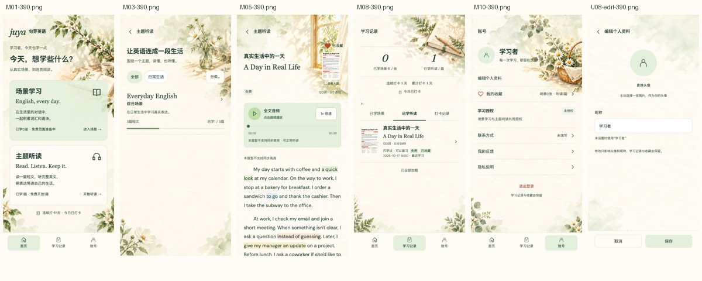

# 整合05／修订17本地实施与验收

2026-10-30。三端功能已在隔离工作树落地，完成一次独立全分支审查及重要问题修复。原运行目录、业务库、账号、配置与媒体保持；本轮没有推送、部署、远程迁移、OSS上传或真实云调用。CLI未修改。三个分支均为`codex/revision17-integration05`，工作树在用户工作区`.worktrees/revision17-integration05/`。

需求真源为用户交付目录中的《句芽英语V1.5完整需求文档-当前确认版.md》，SHA-256见[引用信息](../requirement-reference.json)。2026-10-30 README/同步完成核验及当前Figma替代正文旧“设计待同步”描述。当前55画板、103关联旧状态；旧A10免费M确认与A21导入最终确认停用，160旧稿仅历史。完整需求不重复存入Git。

## 已实施行为

- 分类/主题单项及当前页批量删除；任何真实引用均阻删并分项说明，含软删文章和历史导入候选；不级联、不重归属历史。分类/主题隐藏数字序号，保留版本化完整集合原子排序。主题英文必填中文选填，英文优先，兼容读取旧主题。
- M首次及以后直接保存非负整数和配置版本，兼容旧preview_token。N不联动；授权有效可学全部，未授权/到期/撤销仅最新M，完成不补位。
- DOCX模板/解析统一：中文H1、英文标题/分类/所属主题元信息、三分区、5表达表；兼容主题别名和中英文冒号，唯一名称匹配已有归属，无匹配或重名提示，不自动创建目录。解析错误保留阶段/字段。
- 编辑、行内/当前页批量直接发布；预览和试听可选，必填/可播音频校验保留。发布成功回原文章列表，失败留输入。已有发布状态但草稿有修改时仍可发布新版本。
- 导入核对提供发布或保存草稿双出口。submit_action独立于zip/docx mode，快照绑定批次revision/候选fingerprint/目标revision/动作；逐篇保存和发布原子，回执记录发布version。成功项不重做，部分失败保留，只重试原失败项；重复资料不顺带发布已有对象。
- 两类用户收藏及学习明细先过滤软删再统计分页，下线收藏保留不可用摘要。累计完成、每日数量和打卡日保持历史口径。
- 六张干净背景外置`resources/oss/backgrounds`，实际853×1844并记录SHA，不虚称@3x、不进入微信主包。AppPage按六类页面映射，首页旧背景保留；长文顶部插画按比例、后续纸纹，资源失败仍可读。实际编辑页identity-edit使用BG06；兼容profile包装页仍用账号BG04。
- 正文英文语块四色与Figma一致，按Unicode码点匹配、长语块优先、跨行连续；播放当前字覆盖，短尾迹按媒体时钟冻结/恢复，原文及点词偏移不变；后台只读预览一致。场景/听读收藏成功为实心心形＋已收藏；账号反馈去前置图标，红点与入口保留。下一篇/主题末篇/失败重试分别处理。

## 本次验证范围

| 验证 | 新鲜结果 | 边界 |
| --- | --- | --- |
| API Ruff/check format/mypy | 通过；mypy 77文件 | 最低schema仍0023，本轮无迁移 |
| API完整pytest | 513通过、33跳过 | 临时SQLite；跳过项包含真实云/MySQL/Redis环境专项 |
| 专用MySQL8.4.13 | 37通过 | 仅127.0.0.1:18216/juya_verify；先校验UUID/datadir/bind地址/账号权限 |
| 管理端check/test/build | 通过；220项/54文件 | 审查修复后重跑完整套件 |
| 小程序check/test/H5/微信构建 | 通过；407项/89文件 | 18页/3Tab；源主包1052378B、按20%换算1262854B，余834298B |
| 后台真实本地HTTP浏览器E2E | 2通过 | 当前页勾选/翻页、引用阻删、M关闭刷新、ZIP双出口/错误隔离/960横滑/直接发布 |
| 页面截图 | 42张留证 | 手机390/375，后台1440/960；故障注入截图单独标识 |
| 独立最终审查 | 1项Important已修，无Critical/Minor | 未知提交恢复遇明确409后释放旧pending；见下方回归 |

命令：API `PYTHONPATH=src .venv/bin/python -m ruff check src tests`、`ruff format --check src tests`、`mypy src`、`pytest`；前端各`pnpm check`/`pnpm test`，后台`pnpm build`，小程序`pnpm build:h5`/`pnpm build:mp-weixin:test`。使用现有Python3.13、Node22.22以上且小于23、pnpm11.25.0、FFmpeg。工作树复用忽略的依赖目录，Python显式PYTHONPATH以免导入原目录。

R06：[本地账号/受控时间/M配置/免费集合/资源访问实测](r06-local-evidence.json)来自同一合成账号的实际HTTP响应；覆盖10→1→0、有效/无/撤销/到期授权及旧音频票据GET/HEAD/Range，N不联动、历史保留。原反馈未给可识别账号，不能据此推断其授权事实或宣称已查明原账号原因。

R13：[真实本地持久任务与输入版本](r13-local-task-evidence.json)显示未配置云凭据时job失败为asr_unconfigured，未提交供应商任务；正文与合法完整音频仍可读。测试替身已覆盖有效时间轴、自动任务、输入变更、晚回写、暂停/拖动/倍速与降级；这不等同真实ASR已验收。

001原始ZIP已实际解析并在隔离环境直接发布，标题/正文/译文/5表达/完整音频/可选图均读取。新模板用同一解析器回读通过，损坏DOCX实际区分无法读取及字段缺项。002/003原件缺失，不能用构造样例替代其验收，尤其不能编造002原件的docx_structure根因。

## 审查修复

独立审查发现：先网络未知、查询无回执、原写重发得到409时，复用helper仍保留unknown，新增页面被旧pending锁住。修复为：回执查询失败继续未知；原写的明确业务拒绝结束未知，使页面可刷新revision并重新确认。增加409/422、查询再次断网后恢复已提交version、编辑页解锁再以新revision/新键发布4项回归，先观察3项失败再修复至9项专项全通过；完整管理端220项通过。成功回执恢复仍只产生一次写入/发布版本。

## 追踪和视觉证据

[300条当前需求追踪](traceability.json)、[55当前画板映射](design-frames.json)、[103关联状态规则](legacy-states.json)、[旧35组问题重评](historical-audit-recheck.json)、[证据清单](evidence-manifest.json)。旧问题按固定旧提交重新核对，不直接复制为当前缺陷；旧M强制确认与导入确认意见由最新R10/R11替代。

截图为真实实现和隔离数据。M22/M23为明确故障注入；截图留证不等于每个画板像素验收通过。55+103未逐一真机复验，300条不是全通过率，构建/单测不能替代真实微信/云/原包验收。原有冻结报告保留在上级source目录，不混入本轮通过数。

## 接续与待验

原业务环境未切换到新工作树；不要reset原目录或覆盖已有配置。本地分支保留供审阅，按配套版本三端一起接续。后台/小程序的HANDOFF给出独立本地端口和环境覆盖命令，版本化env中仍可能有远程地址，显式本地覆盖不能省略。

继续需要：002/003原包；原反馈账号标识及当时授权事实；真实ASR/微信设备及已授权云资源验收；55当前/103关联状态逐图设备视觉验收。背景部署需另行上传resources/oss并配置实际静态域名。本轮未替用户进行这些外部动作。

## 实施裁定及代价

- 原生worktree工具不支持嵌套仓库，改用Git工作树；依赖目录用忽略symlink复用，Python指定工作树src、Node22沿用本机工具。代价是接续必须保留或重建依赖链接。
- T298优先于旧删除后数量减少的测试预期：明细隐藏、历史数量保留。若旧报表按可见行数解释，会看到历史数量大于明细行数。
- 主题读取DTO与英文必填写入DTO独立；旧英文空值不补译。代价是历史主题需管理员补英文后才能编辑保存。
- 导入动作与zip/docx mode独立，元信息保存发布version，不编造候选revision。代价是新客户端须与新契约配套。
- 隐藏可见数字但通过公共锁/完整集合/revision保留原子排序，静态order路由先于通配item路由。代价是其他窗口改目录后需刷新排序。
- 听读导入模型加Listening前缀，避免改变既有场景同名OpenAPI模型。代价是生成类型须同步，两前端均已同步。
- 复用既有私有合成MySQL验证实例并先做身份/权限守卫；不用业务账号。代价是离开此机器需重新提供专用验证库，不能照抄凭据。
- 浏览器使用新建隔离SQLite和仅验收侧的微信交换替身，产品H5不加绕过。代价是浏览器结果不代表真实微信身份链路。
- BG06用实际identity-edit路由，profile包装页继承BG04；原图保留853×1844，不伪造3x。代价是更高分辨率素材需另行提供。
- 单管理员规则下目录并发用同账号双会话，未创建虚构第二管理员。代价是该专项证明实际产品会话并发，不宣称多管理员产品支持。
- 审查不判断的云/设备、002/003与全量视觉结论保留待验，未将其降为已通过。代价是本轮可交付本地实现，外部验收尚不能关闭。
